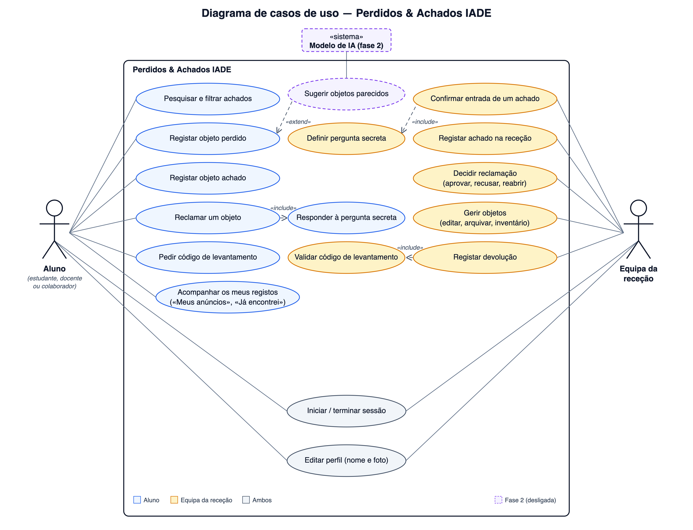

# 4. Casos de uso

Quem usa o sistema e o que pode fazer com ele. O diagrama está em [04-casos-de-uso.png](04-casos-de-uso.png)
(e em [SVG](04-casos-de-uso.svg), para ampliar sem perder qualidade).

## Atores

| Ator | Tipo | Descrição |
|---|---|---|
| **Aluno** | Principal | Estudante, docente ou colaborador do IADE que perde ou encontra um objeto. |
| **Equipa da receção** | Principal | Guarda os objetos entregues, confirma quem é o dono e faz a devolução. |
| **Modelo de IA** | Secundário (sistema) | Compara as descrições e sugere objetos parecidos. Fase 2: implementado, mas desligado nesta entrega. |

## Casos de uso

| # | Caso de uso | Ator | Descrição |
|---|---|---|---|
| UC1 | Iniciar / terminar sessão | Aluno, Equipa | Entrar com email e palavra-passe (5 falhas em 15 min bloqueiam o email) e sair. |
| UC2 | Editar perfil | Aluno, Equipa | Alterar o nome e a fotografia de perfil. |
| UC3 | Pesquisar e filtrar achados | Aluno | Ver os objetos na receção, com pesquisa por texto e filtros de categoria e local. |
| UC4 | Registar objeto perdido | Aluno | Registar uma procura (título, descrição, categoria, local, data e fotografias). |
| UC5 | Registar objeto achado | Aluno | Registar um objeto encontrado (referência ENT-) e entregá-lo na receção. |
| UC6 | Reclamar um objeto | Aluno | Pedir um achado como seu. **Inclui** UC7. |
| UC7 | Responder à pergunta secreta | Aluno | Provar que é o dono, respondendo à pergunta definida pela receção. |
| UC8 | Pedir código de levantamento | Aluno | Com a reclamação aprovada, receber um código de 8 caracteres válido 24 horas. |
| UC9 | Acompanhar os meus registos | Aluno | Separadores de «Meus anúncios» (por entregar, na receção, por levantar, devolvidos, procuras) e «Já encontrei». |
| UC10 | Confirmar entrada de um achado | Equipa | Receber o objeto entregue por um aluno (referência ACH-). **Inclui** UC11. |
| UC11 | Definir pergunta secreta | Equipa | Escrever a pergunta que só o dono sabe responder. |
| UC12 | Registar achado na receção | Equipa | Registar diretamente um objeto entregue ao balcão. |
| UC13 | Decidir reclamação | Equipa | Aprovar, recusar ou reabrir uma reclamação. |
| UC14 | Gerir objetos | Equipa | Editar e arquivar objetos e consultar o inventário. |
| UC15 | Registar devolução | Equipa | Entregar o objeto ao dono. **Inclui** UC16. |
| UC16 | Validar código de levantamento | Equipa | Confirmar o código apresentado ao balcão (o sistema só guarda o seu HMAC-SHA256). |
| UC17 | Sugerir objetos parecidos | Modelo de IA | **Estende** UC4: depois de registar uma procura, mostra os achados mais parecidos. Fase 2. |

## Relações

- **«include»** (sempre acontece): reclamar inclui responder à pergunta secreta; confirmar a entrada inclui definir a pergunta secreta; registar a devolução inclui validar o código.
- **«extend»** (acontece só em certas condições): a sugestão de objetos parecidos pela IA estende o registo de um objeto perdido, quando a IA está ligada.
