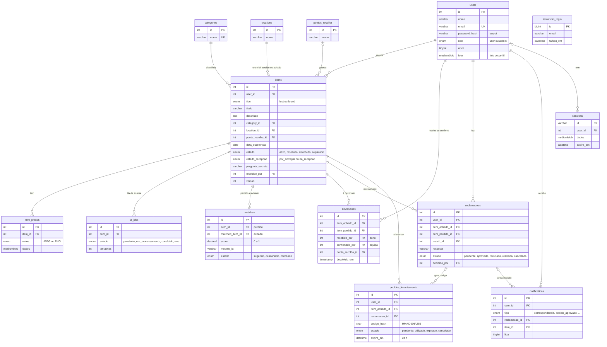

# 5. Base de dados (modelo entidade-relação)

Modelo da base de dados `perdidos_achados` (MariaDB 11.4), igual nos três nós do cluster Galera.
A imagem está em [05-base-de-dados.png](05-base-de-dados.png); o diagrama abaixo é o mesmo, em Mermaid.

Cada tabela mostra a chave primária (PK), as chaves estrangeiras (FK) e as colunas principais.
Notação «pé de galinha»: `||` exatamente um, `|o` zero ou um, `o{` zero ou muitos.

## Tabelas (15)

| Tabela | O que guarda |
|---|---|
| **users** | Contas (aluno ou equipa), palavra-passe em bcrypt e fotografia de perfil. |
| **items** | Objetos perdidos (`lost`) e achados (`found`): descrição, categoria, local, estado, receção e pergunta secreta. |
| **categories** · **locations** · **pontos_recolha** | Listas de referência: categorias, locais do campus e pontos de recolha. |
| **item_photos** | Fotografias dos objetos (JPEG ou PNG, até 2 MB), guardadas na própria base de dados. |
| **reclamacoes** | Pedidos de um aluno para reaver um achado, com a resposta à pergunta secreta e a decisão da equipa. |
| **pedidos_levantamento** | Códigos de levantamento: só o HMAC-SHA256 do código, válido 24 horas. |
| **devolucoes** | Registo de cada entrega: quem recebeu, quem confirmou e onde. |
| **notifications** | Avisos ao aluno (reclamação aprovada, recusada ou reaberta; correspondência da IA). |
| **ia_jobs** | Fila de análises da IA (fase 2), com tentativas e reserva para um só trabalhador. |
| **matches** | Sugestões da IA: par perdido/achado, nota de semelhança (0 a 1) e modelo usado. |
| **sessions** | Sessões iniciadas (guardadas na BD, para valerem em qualquer réplica do web). |
| **tentativas_login** | Tentativas de login falhadas, para bloquear um email ao fim de 5 em 15 minutos. |

## Relações que o diagrama simplifica

Para o diagrama ficar legível, algumas chaves estrangeiras secundárias não têm linha própria:

- `items.recebido_por` → `users` (quem da equipa recebeu o objeto);
- `reclamacoes.item_perdido_id` → `items`, `reclamacoes.match_id` → `matches`, `reclamacoes.decidido_por` e `reaberta_por` → `users`;
- `pedidos_levantamento.user_id` → `users`, `item_perdido_id` → `items` e `match_id` → `matches`;
- `devolucoes.item_perdido_id` → `items`, `match_id` → `matches` e `ponto_recolha_id` → `pontos_recolha`;
- `notifications.item_id` → `items`, `match_id` → `matches` e `ponto_recolha_id` → `pontos_recolha`.

O esquema completo está em `backend/database/perdidos_achados.sql` (32 chaves estrangeiras).
