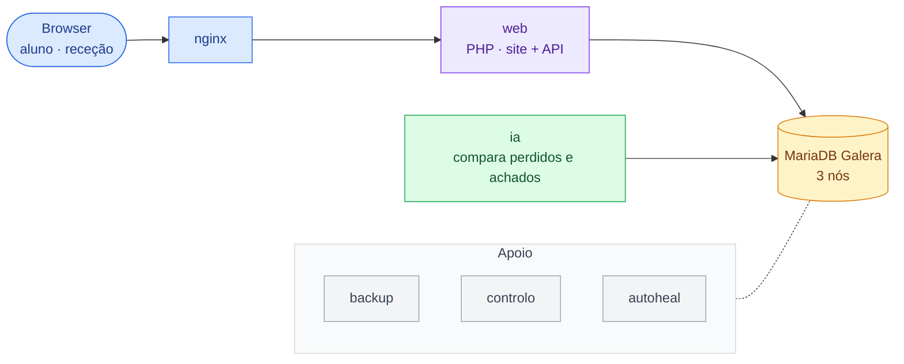

# 1. Arquitetura

O browser só fala com o nginx. O nginx passa os pedidos à aplicação PHP, que guarda tudo num cluster
MariaDB Galera de três nós com os mesmos dados. A IA lê e escreve na mesma base de dados.

| Peça | O que faz |
|---|---|
| nginx | Única porta de entrada (127.0.0.1:8080). |
| web | Páginas do site e API REST em PHP. |
| MariaDB Galera | Três cópias iguais da base de dados; continua a funcionar se cair uma. |
| ia | Compara cada perdido com os achados e grava as sugestões. |
| backup · controlo · autoheal | Cópias de hora a hora · painel de testes e árbitro do cluster · reinicia contentores doentes. |
