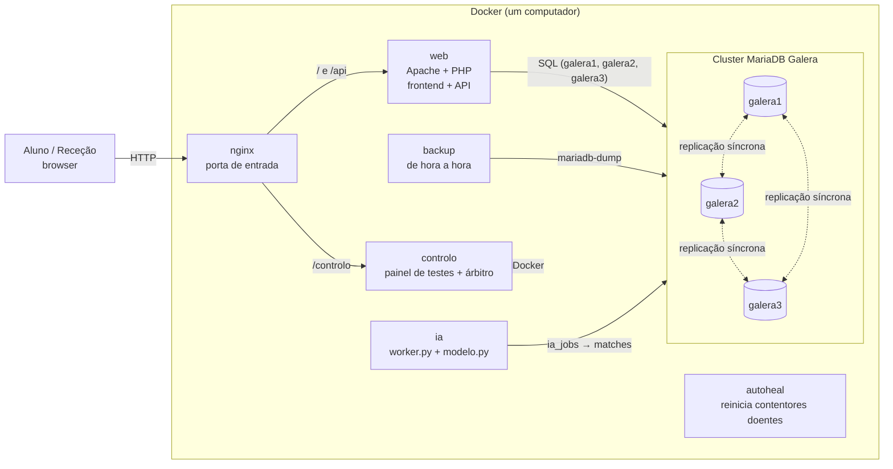

# 1. Arquitetura

O browser só fala com o nginx. O nginx encaminha para o backend PHP, que lê e grava num cluster MariaDB
Galera de três nós com os mesmos dados. A IA, o backup, o painel de controlo e o autoheal correm ao lado.

