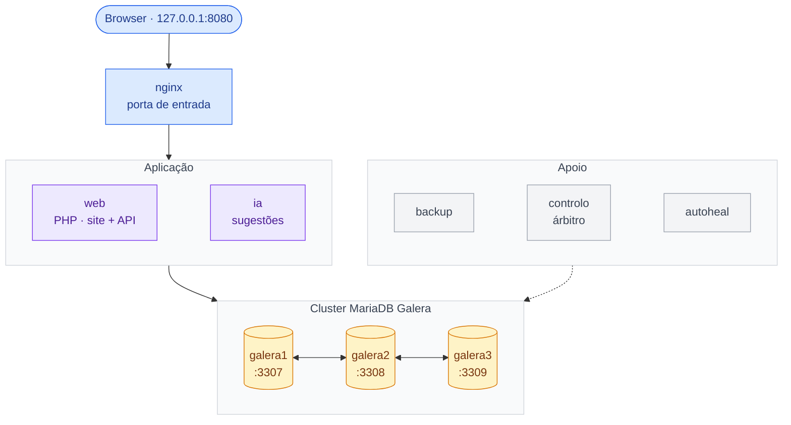

# 1. Infraestrutura distribuída

O sistema corre em contentores Docker ligados por uma rede interna. A base de dados está distribuída
por três nós MariaDB Galera iguais, cada um no seu contentor e com o seu volume de dados. Para fora
só ficam abertos o nginx (127.0.0.1:8080) e os três nós (3307–3309, para ferramentas de administração).

| Nó | Função |
|---|---|
| nginx | Única porta de entrada; passa os pedidos ao web. |
| web | Site e API REST em PHP. Não guarda estado (sessões e fotos estão na BD). |
| ia | Compara perdidos com achados e grava as sugestões. |
| galera1, galera2, galera3 | Três nós da base de dados, cada um com uma cópia completa dos dados. |
| backup · controlo · autoheal | Cópias de hora a hora · árbitro do cluster · reinicia contentores doentes. |
