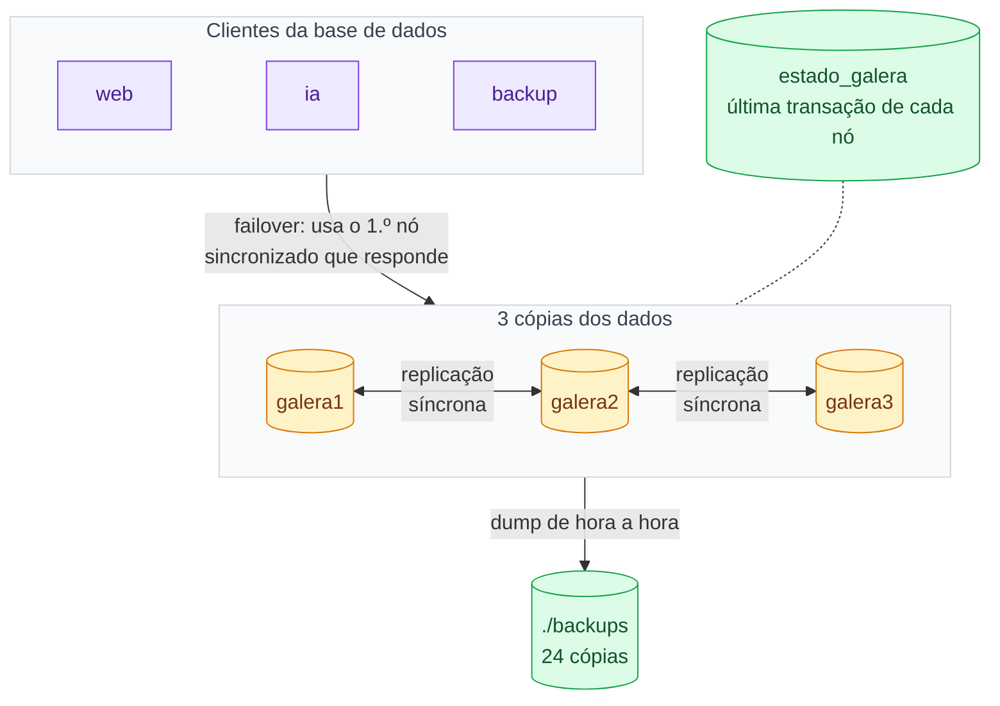

# 2. Mecanismos de redundância

Os dados existem em três cópias completas, mantidas iguais por replicação síncrona: uma escrita só é
confirmada quando o cluster a aceita. Quem usa a base de dados conhece os três nós e passa ao seguinte
se um falhar. Além disso, há cópias de segurança fora dos contentores.

| O que está duplicado | Como |
|---|---|
| Dados | 3 cópias completas (galera1, galera2, galera3) com replicação síncrona; nenhum nó é o «principal». |
| Acesso à base de dados | O web, a IA e o backup recebem a lista `galera1,galera2,galera3` e usam o primeiro nó sincronizado que responder (o PHP desiste de um nó em 2 s). |
| Recuperação de um nó | Um nó que volta recebe só o que perdeu (IST, histórico `gcache` de 128 MB) ou uma cópia completa (SST com `mariabackup`). |
| Estado do cluster | O volume `estado_galera` guarda a última transação de cada nó, para escolher quem refunda o cluster. |
| Cópias de segurança | `mariadb-dump` de hora a hora, 24 cópias guardadas fora dos contentores (`./backups`). |
