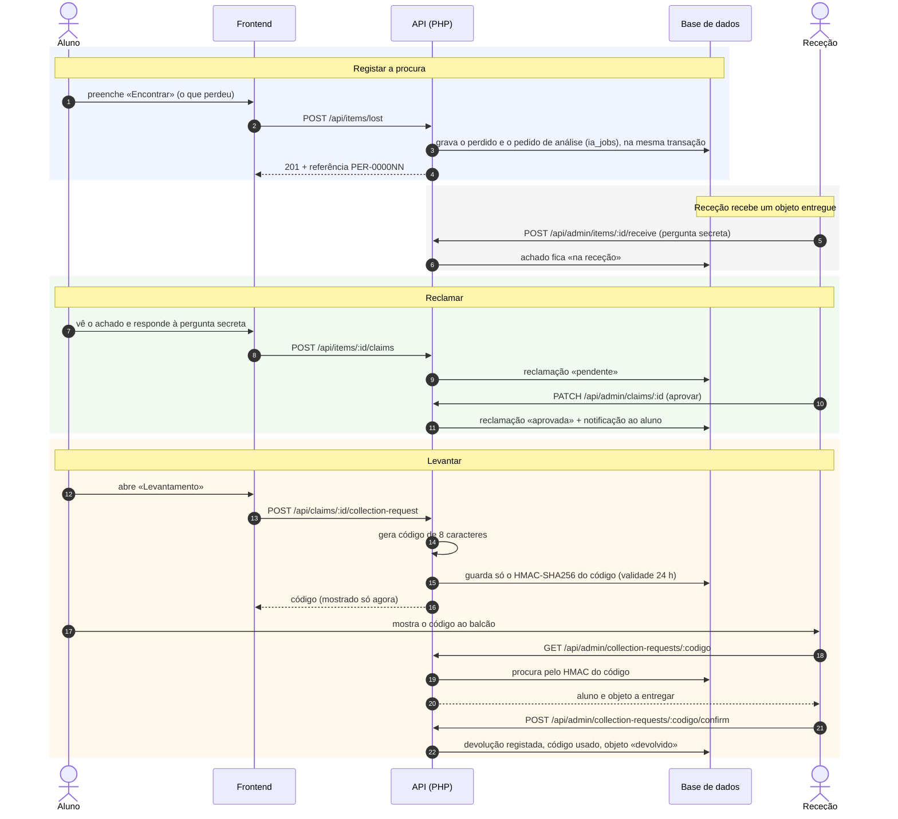

# 3. Sequência: registar procura → reclamar → levantar

O aluno perde um objeto, a receção recebe-o, o aluno prova que é dono e levanta-o com um código.
O código de levantamento nunca é guardado: a base de dados só tem o seu HMAC-SHA256.

