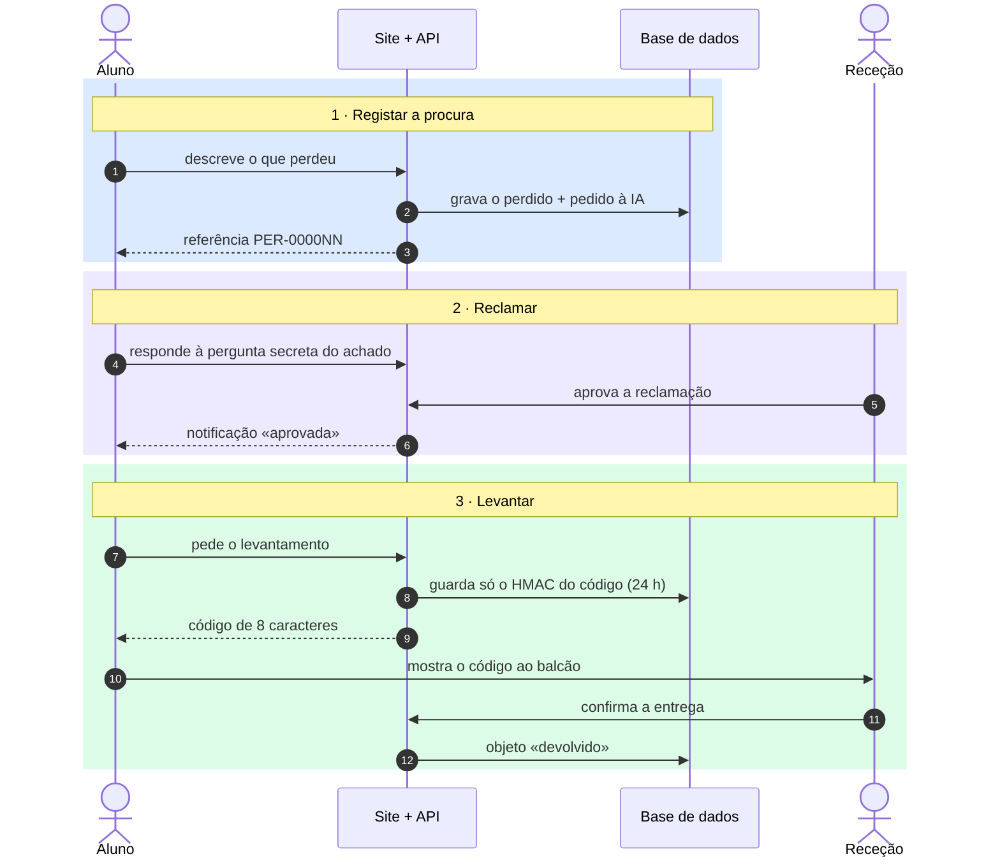

# 3. Sequência: registar procura → reclamar → levantar

O aluno regista o que perdeu, prova que é dono do objeto e levanta-o na receção com um código.
O código nunca é guardado: a base de dados só tem o seu HMAC-SHA256.

