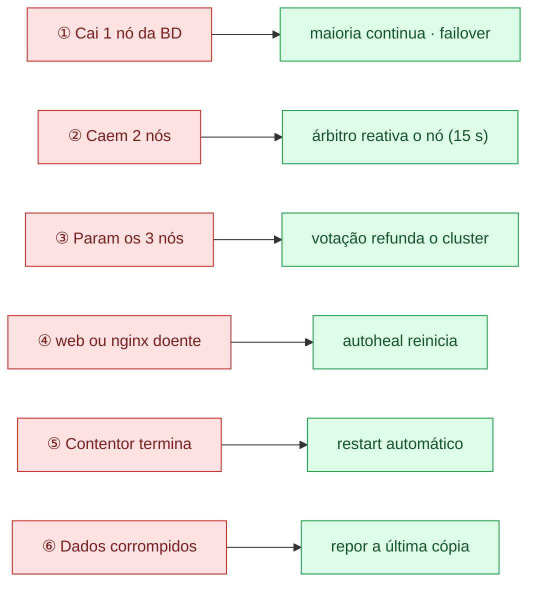

# 3. Tolerância a faltas

Cada falta prevista tem um mecanismo que a deteta e recupera o sistema, quase sempre sem intervenção.
O cluster só aceita escritas com maioria (2 de 3 nós), o que evita duas versões diferentes dos dados.

Modelo de faltas: paragem com recuperação (crash-recovery); não consideramos faltas bizantinas.

| # | Falta | Como o sistema reage |
|---|---|---|
| 1 | Cai 1 nó da BD | Os 2 restantes têm maioria e continuam. O PHP passa ao nó seguinte (desiste em 2 s). Ao voltar, o nó recebe o que perdeu. |
| 2 | Caem 2 nós | O nó que sobra fica sem maioria e não escreve. O árbitro reativa-o ao fim de 15 s. |
| 3 | Param os 3 nós (ex.: desligar o PC) | Votação no volume `estado_galera`: o nó com a última transação refunda o cluster. Plano B manual: `recuperar-cluster.sh`. |
| 4 | web ou nginx doente | O healthcheck falha 3 vezes e o autoheal reinicia o contentor. |
| 5 | Contentor termina | `restart: unless-stopped` volta a arrancá-lo. A BD tem 60 s para parar sem perder o estado. |
| 6 | Dados apagados ou corrompidos | Cópia (`mariadb-dump`) de hora a hora, 24 guardadas; o `repor.sh` restaura. |

**Partição de rede:** só o lado com maioria aceita escritas (evita *split-brain*).

**Limitações (pontos únicos de falha):** uma só instância web e um só nginx (o web aceita réplicas: sessões
e fotos estão na BD); tudo corre num só computador; sem HTTPS (acesso só local, 127.0.0.1).
