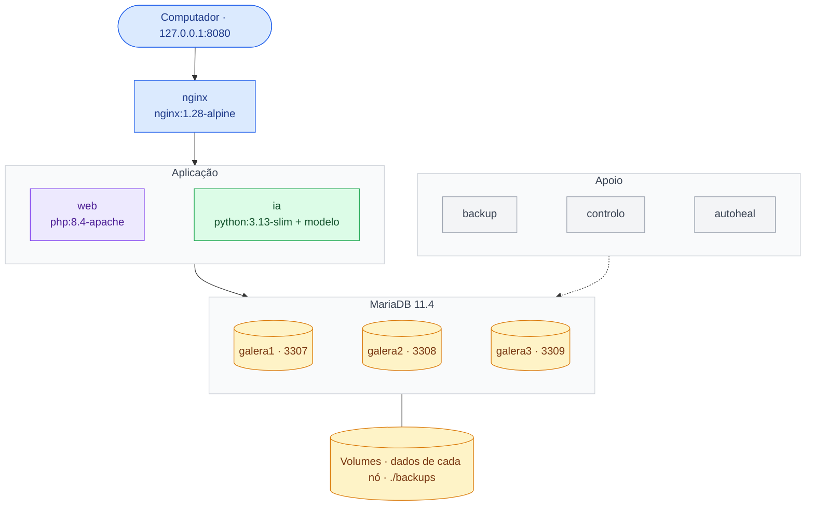

# 4. Implantação (Docker)

Tudo arranca com `docker compose up -d --build`. Para fora do Docker só ficam abertos o nginx
(127.0.0.1:8080) e os três nós da base de dados (3307–3309, para ferramentas de administração).

