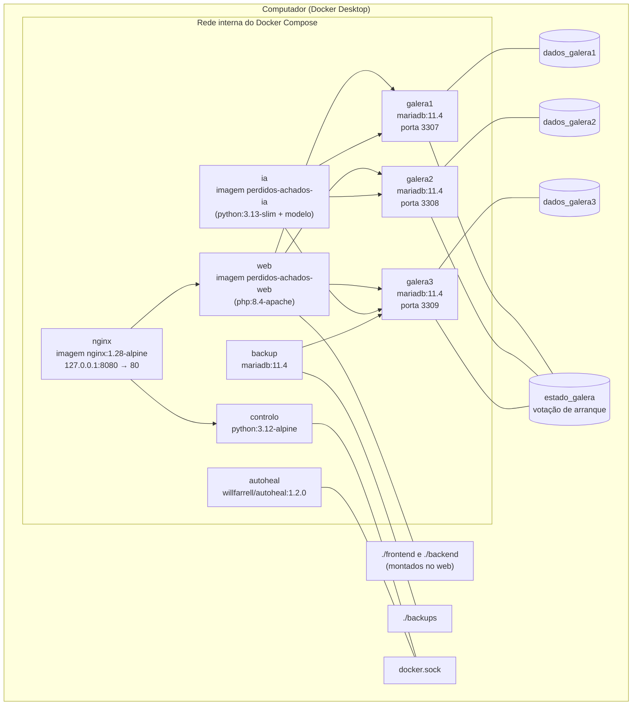

# 4. Implantação (Docker)

Tudo corre com `docker compose up -d --build`. Só o nginx (127.0.0.1:8080) e os três nós da base de dados
(3307–3309, para ferramentas de administração) ficam acessíveis no computador.

