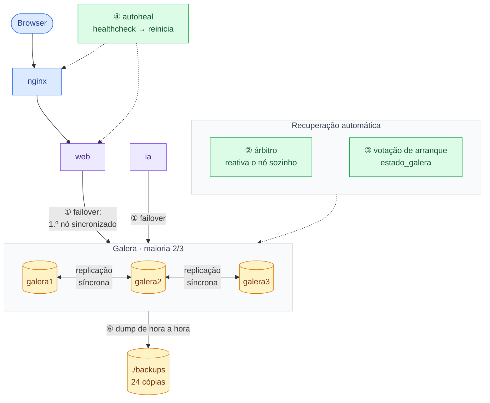

# 5. Infraestrutura distribuída, redundância e tolerância a faltas

Os dados estão em três nós MariaDB Galera com replicação síncrona: cada escrita só é confirmada
quando os nós a aceitam, por isso qualquer nó tem os dados todos. O cluster só aceita escritas com
maioria (2 de 3). A verde estão os mecanismos que recuperam o sistema sozinhos; os números ligam o
diagrama à tabela de faltas.

Modelo de faltas: paragem com recuperação (crash-recovery); não consideramos faltas bizantinas.

## Mecanismos de redundância

| O que está duplicado | Como |
|---|---|
| Dados | 3 cópias completas (galera1, galera2, galera3) com replicação síncrona; nenhum nó é o «principal». |
| Acesso à base de dados | O web, a IA e o backup recebem a lista `galera1,galera2,galera3` e usam o primeiro nó sincronizado que responder. |
| Recuperação de um nó | Um nó que volta recebe só o que perdeu (IST, histórico `gcache` de 128 MB) ou uma cópia completa (SST com `mariabackup`). |
| Estado do cluster | O volume `estado_galera` guarda a última transação de cada nó, para escolher quem refunda o cluster. |
| Cópias de segurança | `mariadb-dump` de hora a hora, 24 cópias guardadas fora dos contentores (`./backups`). |

## Faltas e reação do sistema

| # | Falta | Como o sistema reage |
|---|---|---|
| 1 | Cai 1 nó da BD | Os 2 restantes têm maioria e continuam. O PHP passa ao nó seguinte (desiste em 2 s). Ao voltar, o nó recebe o que perdeu. |
| 2 | Caem 2 nós | O nó que sobra fica sem maioria e não escreve. O árbitro reativa-o ao fim de 15 s. |
| 3 | Param os 3 nós (ex.: desligar o PC) | Votação no volume `estado_galera`: o nó com a última transação refunda o cluster. Plano B manual: `recuperar-cluster.sh`. |
| 4 | web ou nginx doente | O healthcheck falha 3 vezes e o autoheal reinicia o contentor. |
| 5 | Contentor termina | `restart: unless-stopped` volta a arrancá-lo (vale para todos os contentores, por isso não está desenhado). A BD tem 60 s para parar sem perder o estado. |
| 6 | Dados apagados ou corrompidos | Cópia (`mariadb-dump`) de hora a hora, 24 guardadas; o `repor.sh` restaura. |

**Partição de rede:** só o lado com maioria aceita escritas (evita *split-brain*).

**Limitações (pontos únicos de falha):** uma só instância web e um só nginx (o web aceita réplicas: sessões
e fotos estão na BD); tudo corre num só computador; sem HTTPS (acesso só local, 127.0.0.1).
