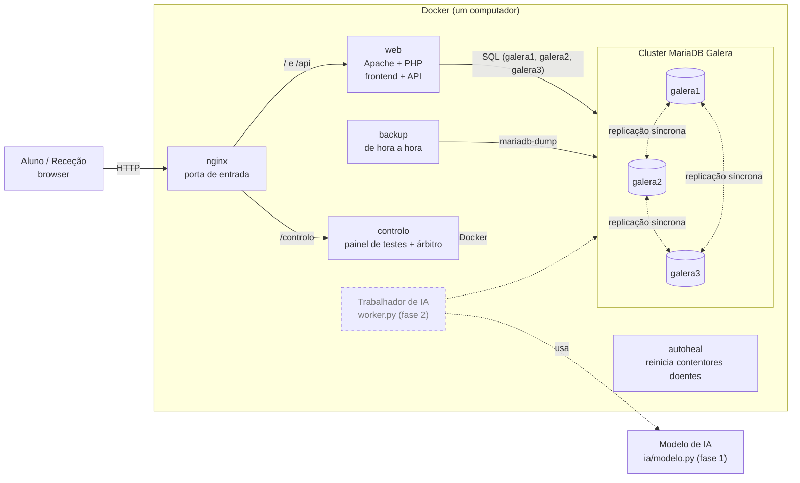
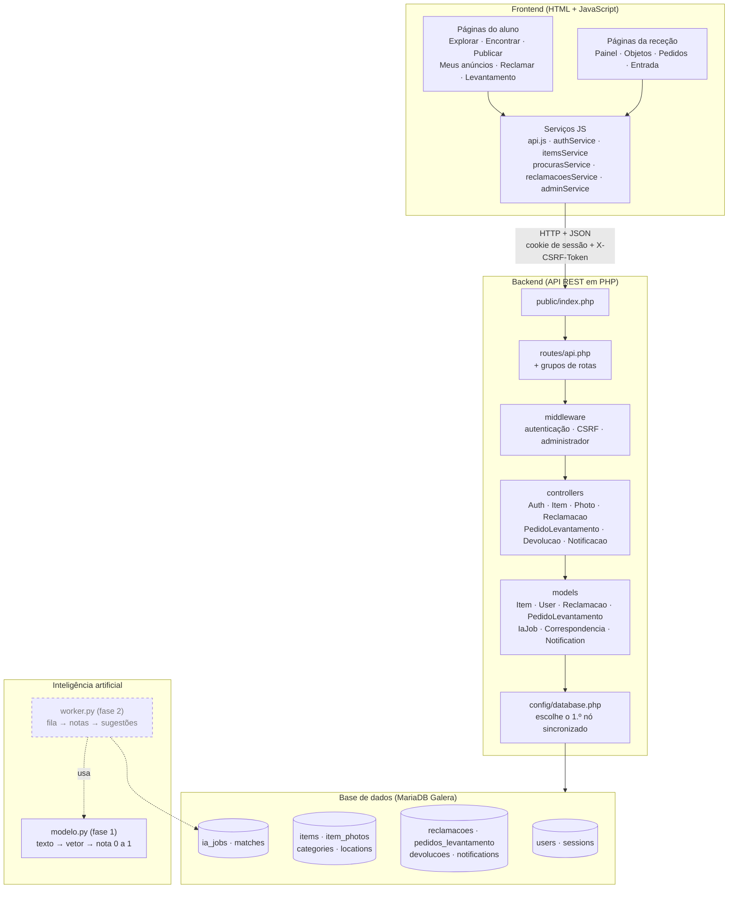
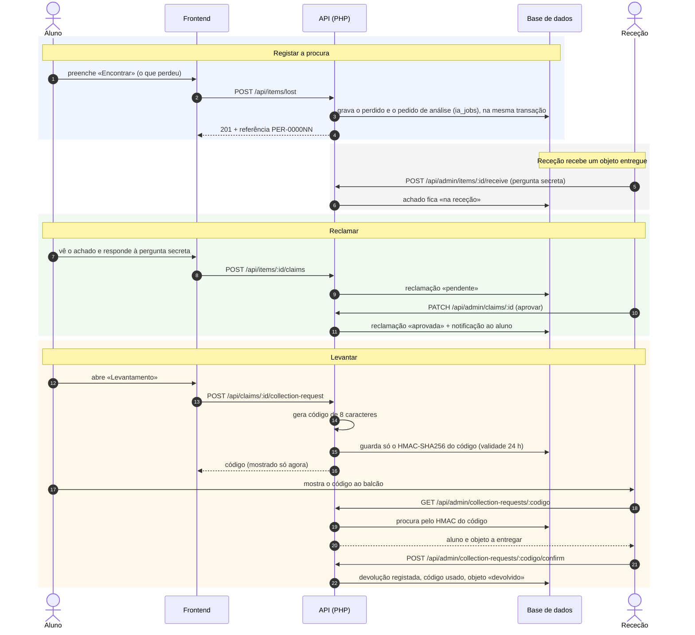
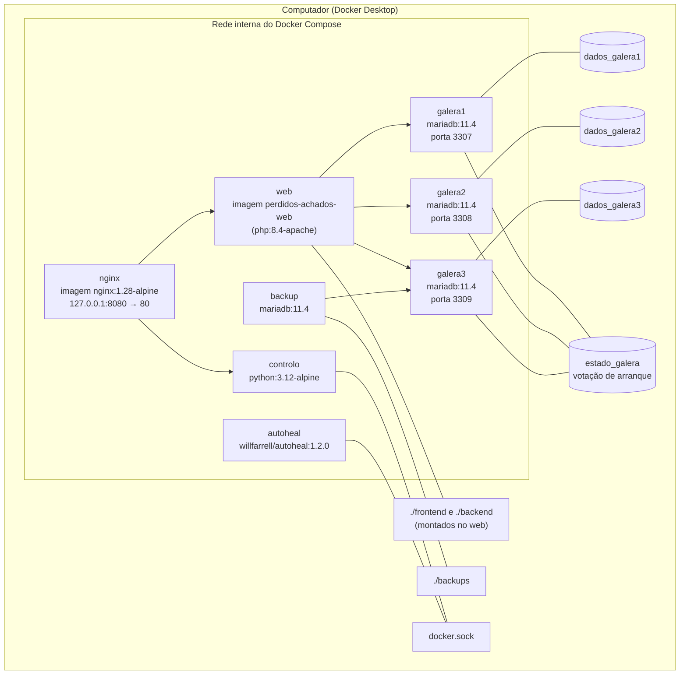
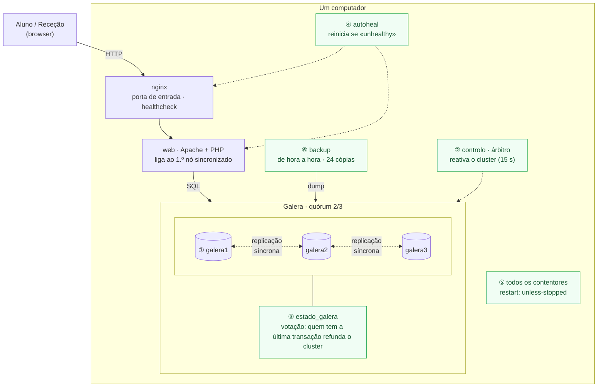

# Diagramas — Perdidos & Achados IADE

Cinco vistas do sistema: arquitetura, componentes, sequência (registar procura → reclamar → levantar),
implantação em Docker e tolerância a faltas. O GitHub desenha os diagramas Mermaid diretamente nesta página.

A tracejado está o que é da **fase 2** da IA (planeado); o resto já existe.

---

## 1. Arquitetura

O browser só fala com o nginx. O nginx encaminha para o backend PHP, que lê e grava num cluster MariaDB
Galera de três nós com os mesmos dados. O backup, o painel de controlo e o autoheal correm ao lado.

---

## 2. Componentes

---

## 3. Sequência: registar procura → reclamar → levantar

O aluno perde um objeto, a receção recebe-o, o aluno prova que é dono e levanta-o com um código.
O código de levantamento nunca é guardado: a base de dados só tem o seu HMAC-SHA256.

---

## 4. Implantação (Docker)

Tudo corre com `docker compose up -d --build`. Só o nginx (127.0.0.1:8080) e os três nós da base de dados
(3307–3309, para ferramentas de administração) ficam acessíveis no computador.

---

## 5. Infraestrutura distribuída e tolerância a faltas

A verde estão os mecanismos que recuperam o sistema sozinhos. Os números ligam o diagrama à tabela.
Modelo de faltas: paragem com recuperação (crash-recovery); não consideramos faltas bizantinas.

| # | Falta | Como o sistema reage |
|---|---|---|
| 1 | Cai 1 nó da BD | Os 2 restantes têm quórum e continuam. O PHP passa ao nó seguinte (desiste em 2 s). Ao voltar, o nó recebe o que perdeu. |
| 2 | Caem 2 nós | O nó que sobra fica sem quórum (não escreve). O árbitro reativa-o ao fim de 15 s. |
| 3 | Param os 3 nós (ex.: desligar o PC) | Votação no volume `estado_galera`: o nó com a última transação refunda o cluster. Plano B manual: `recuperar-cluster.sh`. |
| 4 | web ou nginx doente | O healthcheck falha 3 vezes e o autoheal reinicia o contentor. |
| 5 | Contentor termina | `restart: unless-stopped` volta a arrancá-lo. A BD tem 60 s para parar sem perder o estado. |
| 6 | Dados apagados ou corrompidos | Cópia (`mariadb-dump`) de hora a hora, 24 guardadas; o `repor.sh` restaura. |

**Partição de rede:** só o lado com maioria aceita escritas (evita *split-brain*).

**Limitações (pontos únicos de falha):** uma só instância web e um só nginx (o web aceita réplicas: sessões
e fotos estão na BD); tudo corre num só computador; sem HTTPS (acesso só local, 127.0.0.1).
